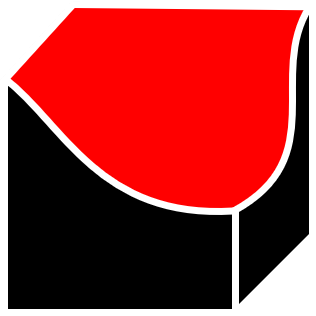

<div align="center">

<picture>
  <source media="(prefers-color-scheme: dark)" srcset="docs/assets/Axis%20Tools%20Dark.png">
  <source media="(prefers-color-scheme: light)" srcset="docs/assets/Axis%20Tools%202.png">
  
</picture>

# Axis Texture Lab

**Next-Gen Native PBR Texture, Normal Map & Procedural Terrain Suite**

[](https://github.com/MooPuu/axis-texture-lab/releases/tag/v2.0.0)
[](https://moopuu.github.io/axis-texture-lab/)
[](https://www.rust-lang.org)
[](https://tauri.app)
[](https://threejs.org)
[](LICENSE)
[](https://github.com/MooPuu/axis-texture-lab/releases/tag/v2.0.0)

<p align="center">
  <a href="https://moopuu.github.io/axis-texture-lab/" target="_blank"><strong>🌐 Visit Official Website & Interactive Showcase</strong></a>
</p>

<p align="center">
  
</p>

*A blazingly fast, lightweight, and modern desktop application designed for game developers, 3D artists, and environment designers. Generate high-quality PBR map sets and procedural terrain heightmaps with instant real-time 3D feedback.*

</div>

---

## 🌟 Overview

**Axis Texture Lab** is part of the **Axis Tools** open-source game development ecosystem. Engineered with a native **Rust + Tauri v2** architecture, it replaces heavy web wrappers with a standalone binary that is over **15× lighter and starts instantly** while retaining a sleek, modern visual interface.

Transform any 2D diffuse/albedo texture into a complete, game-ready PBR material package (Normal, Height, AO, Specular, Roughness, Metallic, Curvature, Slope) with real-time viewport rendering and seeded procedural terrain synthesis.

---

## ✨ Features

### 🎨 Complete PBR Map Generation
- **Normal Maps**: Multi-level Sobel and Scharr gradient filters with customizable strength, blur, detail preservation, and normal format toggle (**DirectX** vs. **OpenGL** Y-axis flip).
- **Height / Displacement Maps**: Accurate luminance and depth mapping with optional **16-bit PNG** high-dynamic-range heightmap export.
- **Ambient Occlusion (AO)**: Ray-tested or convolution-based local surface contact shadow generation with adjustable sample radius and intensity.
- **Roughness & Metallic**: Inverse specular, micro-surface contrast, and metallic threshold masking.
- **Curvature & Slope Maps**: Convex/concave edge extraction for vertex blending and terrain masks.

### 🎮 Interactive 3D Viewport
- **Real-Time Three.js Renderer**: Orbit, pan, and zoom around materials with dynamic physical shaders.
- **Multiple Geometries**: Instant switching between Cube, Sphere, Plane, Cylinder, and Torus meshes.
- **Custom Lighting**: Studio, Dramatic, Outdoor presets, or full manual control over Key, Fill, Ambient, and Rim lights.
- **Visual Aids**: Wireframe overlay, auto-rotation toggle, reset camera, and one-click viewport screenshot snapshot.

### 🏔️ Procedural Terrain Randomizer
- **Seeded Terrain Synthesis**: Generate infinite procedural terrain landscapes and heightmaps using customizable frequency scale, octaves, persistence, and lacunarity.
- **Live 3D Terrain Preview**: Interactive wireframe and shaded terrain mesh with altitude color coding.
- **Seamless Generator Bridge**: Click **"Use in Generator"** to automatically send the generated terrain heightmap into the PBR engine to bake full normal, roughness, and AO terrain materials.

### 🔍 Seamless Tiling & Seam Analysis
- **Edge Mismatch Detection**: Computes mathematical boundary pixel discrepancy to quantify tileability.
- **Tiling Preview**: 1×1, 2×2, 3×3, and 4×4 pattern repeats to spot repeating seams instantly.

### 📦 Batch Processing & Custom Presets
- **Folder Batch Processing**: Automatically convert dozens of textures in a directory with consistent naming conventions (`_normal`, `_height`, `_ao`, `_roughness`, etc.).
- **Preset Management**: Save, export, and import custom generator settings as JSON profiles.
- **Multi-Theme Support**: Dark, Light, Midnight, and Ocean UI color schemes.

---

## 🚀 Downloads & Installation

Cross-platform release packages for **Windows**, **macOS**, and **Linux** are available on the [v2.0.0 Release Page](https://github.com/MooPuu/axis-texture-lab/releases/tag/v2.0.0):

### 🪟 Windows (10 & 11, 64-bit)
| Package | Description | Download | Size |
|---|---|---|---|
| **Standalone Portable** | Zero installation required. Run directly. | [**AxisTextureLab-v2.0.0-windows-x64.exe**](https://github.com/MooPuu/axis-texture-lab/releases/download/v2.0.0/AxisTextureLab-v2.0.0-windows-x64.exe) | ~9.2 MB |
| **Portable Zip Package** | Includes executable, icon, and quick-start docs. | [**AxisTextureLab-v2.0.0-windows-portable.zip**](https://github.com/MooPuu/axis-texture-lab/releases/download/v2.0.0/AxisTextureLab-v2.0.0-windows-portable.zip) | ~2.9 MB |
| **Standard Installer (NSIS)** | Desktop & Start Menu shortcuts, clean uninstaller. | [**AxisTextureLab-v2.0.0-setup.exe**](https://github.com/MooPuu/axis-texture-lab/releases/download/v2.0.0/AxisTextureLab-v2.0.0-setup.exe) | ~2.2 MB |
| **Enterprise Installer (MSI)** | Windows Installer package. | [**AxisTextureLab-v2.0.0-x64.msi**](https://github.com/MooPuu/axis-texture-lab/releases/download/v2.0.0/AxisTextureLab-v2.0.0-x64.msi) | ~3.3 MB |

### 🍎 macOS (Apple Silicon & Intel)
| Package | Description | Download | Size |
|---|---|---|---|
| **Universal DMG Package** | Drag-and-drop installer for Apple Silicon (M1-M4) & Intel Macs. | [**AxisTextureLab-v2.0.0-macos-universal.dmg**](https://github.com/MooPuu/axis-texture-lab/releases/download/v2.0.0/AxisTextureLab-v2.0.0-macos-universal.dmg) | ~8.5 MB |
| **App Bundle Tarball** | Compressed `.app` application archive. | [**AxisTextureLab-v2.0.0-macos-universal.app.tar.gz**](https://github.com/MooPuu/axis-texture-lab/releases/download/v2.0.0/AxisTextureLab-v2.0.0-macos-universal.app.tar.gz) | ~7.8 MB |

### 🐧 Linux (x86_64)
| Package | Description | Download | Size |
|---|---|---|---|
| **Universal AppImage** | Portable executable. Runs on all major Linux distributions. | [**AxisTextureLab-v2.0.0-linux-x86_64.AppImage**](https://github.com/MooPuu/axis-texture-lab/releases/download/v2.0.0/AxisTextureLab-v2.0.0-linux-x86_64.AppImage) | ~9.0 MB |
| **Debian / Ubuntu Package** | Native `.deb` package installer. | [**AxisTextureLab-v2.0.0-linux-amd64.deb**](https://github.com/MooPuu/axis-texture-lab/releases/download/v2.0.0/AxisTextureLab-v2.0.0-linux-amd64.deb) | ~3.1 MB |
| **Binary Tarball** | Standalone Linux executable bundle. | [**AxisTextureLab-v2.0.0-linux-x86_64.tar.gz**](https://github.com/MooPuu/axis-texture-lab/releases/download/v2.0.0/AxisTextureLab-v2.0.0-linux-x86_64.tar.gz) | ~2.8 MB |

> **System Requirements:** Windows 10/11 with WebView2 • macOS 11.0+ (Big Sur or newer) • 64-bit Linux with WebKit2GTK 4.1.

---

## 🛠️ Architecture & Tech Stack

```
Axis Texture Lab
├── Backend (Rust)
│   ├── Tauri v2 (lib.rs, main.rs)
│   ├── RFD (Native OS file & directory pickers)
│   └── Native File I/O
└── Frontend
    ├── Modern Vanilla JS + HTML5 Canvas
    ├── Three.js r150 (Physical PBR Shading & Orbit Controls)
    ├── Duotone SVG Sprites (Solar, Iconsax, Scarlab)
    └── Tauri v2 IPC Bridge (tauri-bridge.js)
```

---

## 💻 Building from Source

### Prerequisites
1. **Rust & Cargo** (v1.77+): Install via [rustup.rs](https://rustup.rs).
2. **Node.js** (v18+): Install via [nodejs.org](https://nodejs.org).
3. **C++ Build Tools**: Microsoft C++ Build Tools (via Visual Studio Installer).

### Steps

1. **Clone the repository:**
   ```bash
   git clone https://github.com/MooPuu/axis-texture-lab.git
   cd axis-texture-lab
   ```

2. **Run in development mode:**
   ```bash
   npx @tauri-apps/cli dev
   ```

3. **Build the release binary & installers:**
   ```bash
   npx @tauri-apps/cli build
   ```
   Compiled binaries and installers will be generated under `src-tauri/target/release/` and `src-tauri/target/release/bundle/`.

---

## 📄 License

This project is open-source and released under the **MIT License**. See [LICENSE](LICENSE) for details.

---

## 👤 Author & Credits

- **Creator & Lead Developer**: Mahdi Kareem (MooPuu)
- **Organization**: [Axis Tools](https://github.com/MooPuu) — *The Open Source Game-Dev Stack*
- Copyright &copy; 2026 Mahdi Kareem. All rights reserved.
